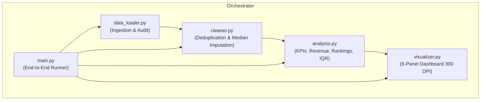

# Source Code Technical Documentation (`src/`)
## Project 13: Hotel Booking & Occupancy Analysis

This document provides a comprehensive technical overview of all source modules contained in `src/` (and mirrored in `docs/src/`).

---

## 1. Module Overview & Dependency Graph



---

## 2. Module Specifications

### 2.1 `src/data_loader.py` (Data Ingestion & Quality Audit)
* **Purpose:** Safely resolves the dataset path across multiple candidate directories, ingests raw records, and audits data quality.
* **Key Functions:**
  * `get_dataset_path(filename="13_hotel_bookings.csv")`: Dynamically searches relative, parent, `data/raw/`, and absolute fallback paths to guarantee file discovery.
  * `load_and_inspect_data(filepath=None)`: Reads CSV via Pandas; prints shape (1,225 rows, 9 columns), column names, `head()`, `info()`, and `describe()`.
  * `audit_quality(df)`: Detects null values per column and checks duplicate `Booking_ID` records (identifying 25 exact row duplicates).

### 2.2 `src/cleaner.py` (Cleansing & Feature Engineering)
* **Purpose:** Cleans raw records, imputes missing values using domain-justified median statistics, and generates engineered temporal features.
* **Key Functions:**
  * `clean_and_prepare_data(df_raw, save_processed=True)`:
    1. **Deduplication:** Drops duplicate `Booking_ID` records, keeping the first occurrence (1,225 -> 1,200 rows).
    2. **Median Imputation (`Room_Rate`):** Imputes missing values by `Room_Type` median (Standard: ₹3,608; Deluxe: ₹5,642; Suite: ₹9,732).
    3. **Median Imputation (`Lead_Time_Days`):** Imputes missing values by `Room_Type` median (Standard/Deluxe: 29 days; Suite: 31 days).
    4. **Categorical Imputation (`Booking_Channel`):** Fills 8 missing channels with `'Unknown'`.
    5. **Temporal Extraction:** Converts `Checkin_Date` to datetime; extracts `Arrival_Year_Month` (`YYYY-MM`), `Arrival_Month_Name`, `Arrival_Weekday`, and `Is_Weekend_Arrival`.
    6. **Lead-Time Binning:** Uses `pd.cut()` to create `Last-Minute (0-7d)`, `Short-Term (8-30d)`, and `Advance (31+d)`.
    7. **Realized Revenue Calculation:** Row-wise calculation:
       $$\text{Revenue} = \text{np.where}(\text{Canceled} == \text{'No'}, \text{Nights} \times \text{Room\_Rate}, 0.0)$$
    8. **Data Export:** Saves cleansed records to `data/processed/hotel_bookings_cleaned.csv`.

### 2.3 `src/analysis.py` (Business Logic & Statistical Engine)
* **Purpose:** Calculates hospitality KPIs, room-type metrics, channel performance rankings, NumPy statistics, and IQR outliers.
* **Key Functions:**
  * `compute_overall_kpis(df)`: Computes Total Bookings (1,200), Total Demanded Nights (3,921), Realized Nights (3,023), Canceled Bookings (262), Overall Cancellation Rate (21.83%), Realized Revenue (₹1,63,41,201.00), and Lost Revenue (₹50,43,535.00).
  * `analyze_room_types(df, ...)`: Generates Deliverable 1 (Deluxe generates ₹69.35L / 42.44% share; Standard generates ₹54.56L; Suite generates ₹39.50L).
  * `rank_booking_channels(df, ...)`: Generates Deliverable 2 (OTA: 39.75% vol, 32.70% cancellation; Direct Website: 29.50% vol, 16.95% cancellation).
  * `analyze_cancellations_by_lead_band(df)`: Generates Channel x Lead-Time cancellation pivot matrix and multi-level groupby `['Room_Type', 'Booking_Channel']`.
  * `identify_peak_months(df)`: Generates Deliverable 3 (Top 3 months: Dec: ₹17.97L, Jan: ₹17.41L, Oct: ₹17.02L; Jul has peak room nights: 333).
  * `compare_traveler_segments(df, ...)`: Contrasts Leisure (4.02 nights avg stay, ₹1.22 Crore revenue) vs Business (2.18 nights avg stay, ₹41.02 Lakh revenue).
  * `calculate_numpy_metrics(df)`: Uses NumPy for room rate Mean (₹5,457.73), Median (₹4,816.50), Sample Std Dev (₹2,563.22), Min (₹2,643.00), and Max (₹35,867.00).
  * `detect_revenue_outliers_iqr(df)`: Uses IQR method on realized revenue (Q1: ₹7,561.25; Q3: ₹22,136.25; IQR: ₹14,575.00; Upper Fence: ₹43,998.75). Identifies 50 high-value bookings.

### 2.4 `src/visualizer.py` (Visualization & Chart Generator)
* **Purpose:** Renders an executive 6-panel dashboard using Matplotlib and Seaborn.
* **Key Functions:**
  * `generate_executive_dashboard(...)`: Plots:
    1. Dual-axis Monthly Revenue (bar) & Realized Nights (line).
    2. Channel Cancellation Rate (%) bar chart with percentage labels.
    3. Room-Type Revenue Share pie/donut chart.
    4. Channel vs. Lead-Time Band cancellation rate heatmap.
    5. Stay Duration distribution boxplot (Leisure vs. Business) with red diamond mean markers.
    6. Check-in Arrivals by Weekday bar chart for front-desk scheduling.
  * Exports chart to `outputs/hotel_booking_analysis_dashboard.png` at 300 DPI.

### 2.5 `src/main.py` (Pipeline Orchestrator)
* **Purpose:** Runs the entire pipeline sequentially from ingestion to reporting with clean console outputs.
* **Usage:**
  ```bash
  python src/main.py
  # or from docs:
  python docs/src/main.py
  ```

---

## 3. Execution Verification

All modules have been verified and tested end-to-end with exit code 0. Cleaned data is saved in `data/processed/` and dashboard visuals in `outputs/`.
